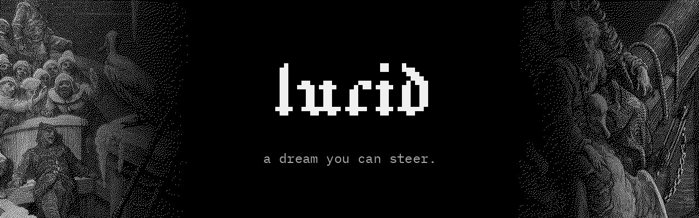
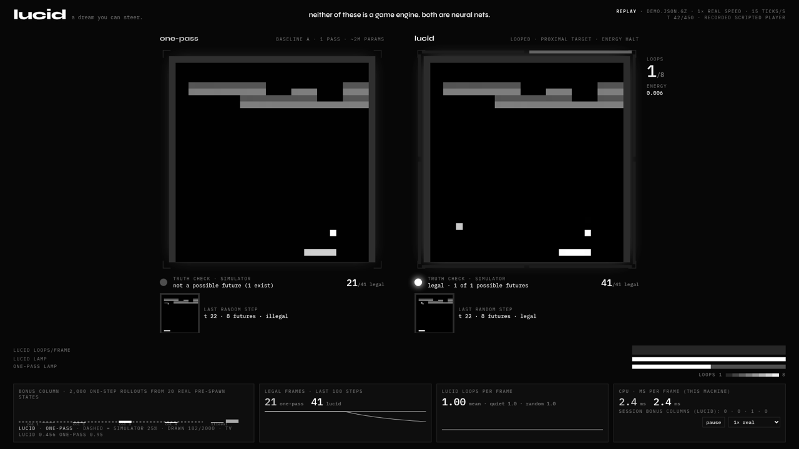
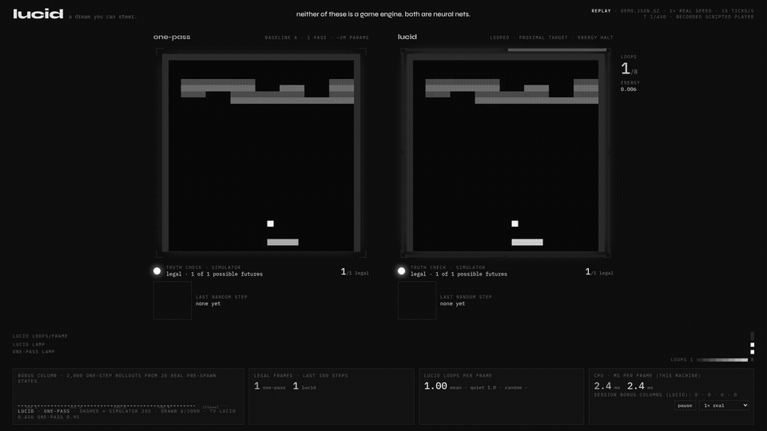
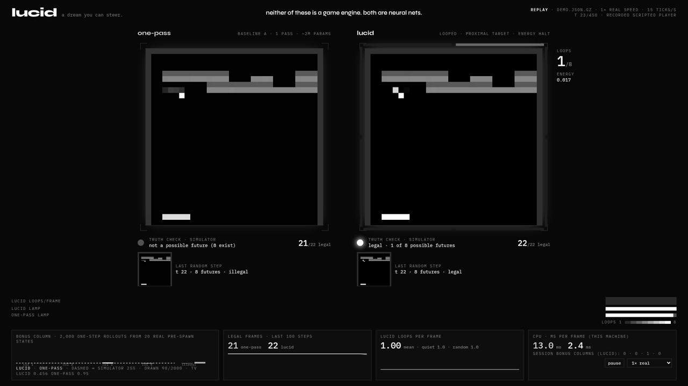
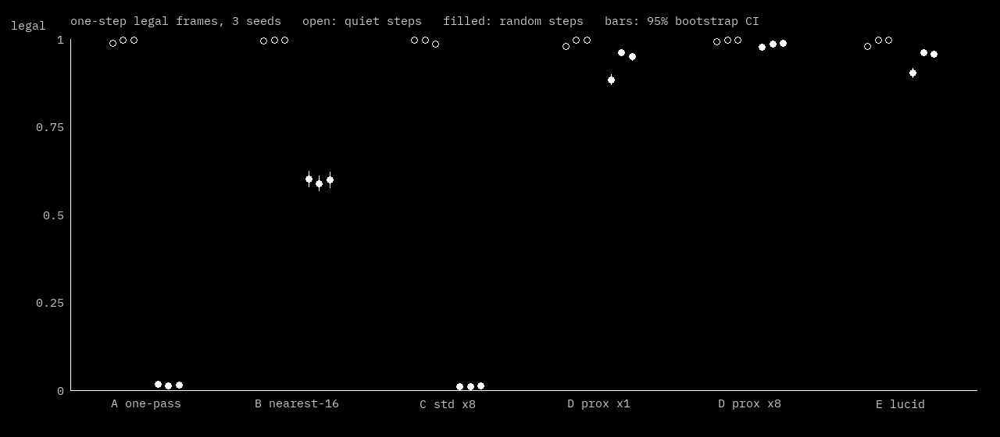
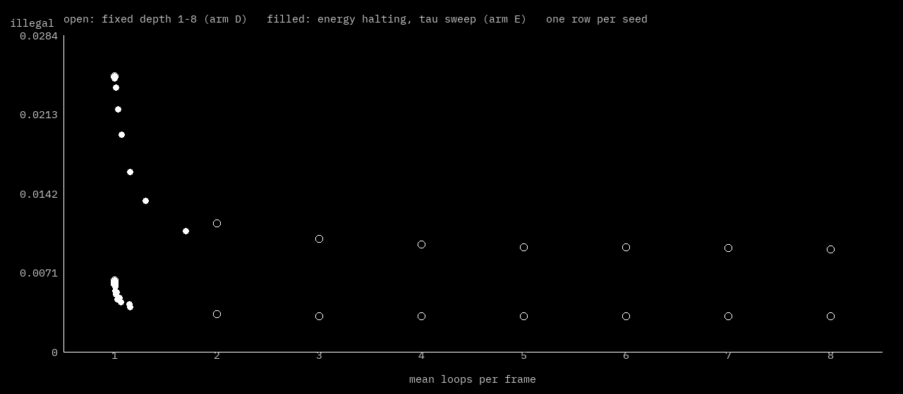
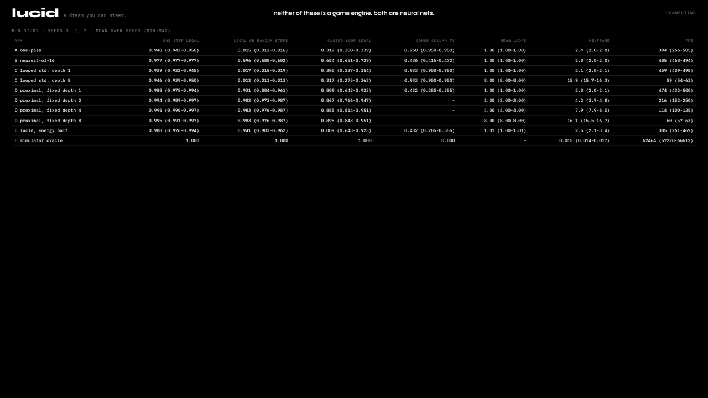

lucid is a game that exists only inside a looped neural network on a CPU. A 1.8M-parameter world model dreams the next 32x32 frame of a small brick-and-paddle game, loop by loop, and you steer the paddle with the arrow keys. A lamp under each screen asks the real simulator whether the dreamed frame could have happened.

#ai-frontier-research #world-models #looped-transformers #recurrent-depth #game-ai #energy-based-models #cpu-inference #pytorch

   





16:9 and 9:16 footage at 1080p: `docs/media/lucid-16x9.mp4`, `docs/media/lucid-9x16.mp4` (shot list in `docs/SHOT_LIST.md`).

## The Smear

When a brick breaks, the game drops a bonus in one of its four columns, in one of two colours. Eight futures are possible and the next frame shows exactly one.

A model trained to predict the stored next frame cannot know which one. It learns the average: a faint bonus in several places at once, which is not a frame the game can ever produce. The one-pass baseline gets 95% of all frames exactly right, but only 1.5% of the frames with a random event (3 seeds, 40,000 test transitions).



## The Loop

lucid is the same 1.8M-parameter network, run in a loop. Its first pass starts from a noise draft. Each loop reads the previous frames, the action and its own last guess, and refines the guess.

It is trained toward the nearest legal future: the simulator lists every frame that could come next, and the target is the one the model already likes most. Different noise settles on different legal frames instead of their average. With that target, 88% to 96% of random-event frames are exactly legal after one loop and 97% to 99% after two. Trained on the stored frame, the same looped model stays at about 1.5%.

The ring around lucid's screen fills one segment per loop. The filmstrip below colours every past frame by loops used.



## The Lamp

Under each screen is a lamp. It asks the real simulator, never the model, for every possible next frame, and lights white when the dreamed frame matches one of them cell for cell. It stays grey otherwise.

In the recorded session, lucid's lamp is lit on 58% of 450 frames and one-pass's on 35%. The rates are lower than one-step, because a dream that goes wrong can stay wrong until the next restart. In the metric (100-step scripted play, 50 rollouts per seed) lucid is legal on 0.64, 0.92 and 0.86 of frames.

## The Halt

A small energy head scores each guess; lucid stops looping when the energy says the frame looks legal. The hope was more loops on spawns and collisions, fewer on quiet frames. A published result (arXiv 2607.10203) says trained routers do not beat fixed depth. lucid tested that claim.

It agrees. The energy is confident almost everywhere, so lucid stops after one loop (mean 1.01). Loops barely track how many futures a frame has (Spearman 0.07 to 0.13, target 0.5). At equal compute it is 2% to 6% better than fixed depth, short of the 10% it needed. With a much lower threshold, chosen after the fact, halting does better than fixed depth at the same mean loops. That is a hint, not a result.



## The Results

<!-- results:start -->
Run `study`, seeds 0, 1, 2; test set 40,000 real transitions (1,902 random steps). Mean over seeds, (min-max) across seeds.

| arm | one-step legal | legal on random steps | closed-loop legal | bonus column TV | mean loops | ms/frame | FPS |
|---|---|---|---|---|---|---|---|
| A one-pass | 0.948 (0.943-0.950) | 0.015 (0.012-0.016) | 0.319 (0.300-0.339) | 0.950 (0.950-0.950) | 1.00 (1.00-1.00) | 2.4 (2.0-2.8) | 394 (266-505) |
| B nearest-of-16 | 0.977 (0.977-0.977) | 0.596 (0.588-0.602) | 0.684 (0.651-0.729) | 0.436 (0.415-0.472) | 1.00 (1.00-1.00) | 2.0 (2.0-2.0) | 485 (468-494) |
| C looped std, depth 1 | 0.939 (0.922-0.948) | 0.017 (0.015-0.019) | 0.300 (0.237-0.354) | - | 1.00 (1.00-1.00) | 2.1 (2.0-2.1) | 459 (409-498) |
| C looped std, depth 8 | 0.946 (0.939-0.950) | 0.012 (0.011-0.013) | 0.317 (0.275-0.363) | - | 8.00 (8.00-8.00) | 15.9 (15.7-16.3) | 59 (54-63) |
| D proximal, fixed depth 1 | 0.988 (0.975-0.994) | 0.931 (0.884-0.961) | 0.809 (0.643-0.923) | - | 1.00 (1.00-1.00) | 2.0 (2.0-2.1) | 474 (432-500) |
| D proximal, fixed depth 2 | 0.994 (0.989-0.997) | 0.982 (0.973-0.987) | 0.867 (0.766-0.947) | - | 2.00 (2.00-2.00) | 4.2 (3.9-4.8) | 216 (152-250) |
| D proximal, fixed depth 4 | 0.995 (0.990-0.997) | 0.983 (0.976-0.987) | 0.885 (0.814-0.951) | - | 4.00 (4.00-4.00) | 7.9 (7.9-8.0) | 114 (100-125) |
| D proximal, fixed depth 8 | 0.995 (0.991-0.997) | 0.983 (0.976-0.987) | 0.895 (0.843-0.951) | - | 8.00 (8.00-8.00) | 16.1 (15.5-16.7) | 60 (57-63) |
| E lucid, energy halt | 0.988 (0.976-0.994) | 0.941 (0.903-0.962) | 0.809 (0.643-0.923) | 0.432 (0.285-0.555) | 1.01 (1.00-1.01) | 2.5 (2.1-3.4) | 385 (261-469) |
| F simulator oracle | 1.000 | 1.000 | 1.000 | 0.000 | - | 0.015 (0.014-0.017) | 62464 (57228-66612) |

| seed | lucid illegal at halt | best fixed depth illegal at same mean loops | mean loops | Spearman loops vs futures |
|---|---|---|---|---|
| 0 | 0.0237 | 0.0245 | 1.01 | 0.1019 |
| 1 | 0.0060 | 0.0061 | 1.00 | 0.0674 |
| 2 | 0.0060 | 0.0064 | 1.00 | 0.1301 |
<!-- results:end -->

The hypothesis fails by its own rule: the halting clause missed on all three seeds. Two more clauses missed. lucid is slightly slower per frame than nearest-of-16 (2.1 to 3.4 ms vs 2.0 ms). Its bonuses are legal but pile onto 3 or 4 of the 8 outcomes (column TV 0.29 to 0.56, target 0.10). Every clause, every seed, the smoke runs and the limitations are in [docs/REPORT.md](docs/REPORT.md). The tables above are regenerated from `results/` by `make results`.



## Install

```sh
git clone https://github.com/Sebastianrodaaa/lucid && cd lucid
make setup                     # .venv with CPU PyTorch (download.pytorch.org/whl/cpu), numpy, pillow, websockets
make test                      # dry run: simulator, lamp, proximal target, tiny training, README tables
make play                      # checks checkpoints/SHA256SUMS, serves http://127.0.0.1:8000/ and opens it
make replay                    # the recorded run, at real speed
```

It touches only this folder: `.venv/` (about 1 GB with PyTorch), `.cache/` (generated simulator data) and `runs/` (training runs). Undo with `rm -rf .venv .cache runs`. The released checkpoints are in `checkpoints/` with SHA-256 sums. No API key, no GPU, no download besides the Python packages. `make study` reruns the full experiment (about 10 hours on 8 vCPU), `make results` rewrites the tables from `results/`.

## The Name

A lucid dream is one where the dreamer knows the rules and can steer. lucid is a dream with a rulebook next to it.

## Inspirations

Looped World Models, nearest-of-m one-step world models, Proximal Targets, Energy-Based Reasoners, Adaptive compute in latent world models, DIAMOND, GameNGen and Neural Game Engine. Links and what lucid takes from each: [INSPIRATIONS.md](INSPIRATIONS.md). Method and every run: [docs/REPORT.md](docs/REPORT.md).

## License

MIT, see [LICENSE](LICENSE). Third-party terms (PyTorch, Syne, IBM Plex Mono, Jacquard 12, Gustave Doré's 1876 plates) are in [NOTICE.md](NOTICE.md).
